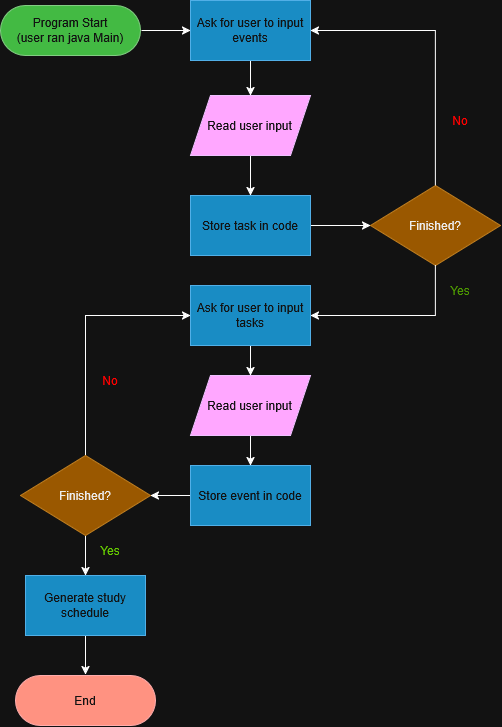

# CS 193 Final Project: Study Scheduler

A command line tool that can take in when the user is busy (i.e. when they have events), take in their tasks such as homework or studying, then use that information to generate a study scheduler built around where the student has space.

## The Problem

I often have trouble managing my time effectively. I spend too long on some assignments that shouldn't take that much effort while not giving myself enough time for more important/harder ones, especially with studying for exams. I made this project to try to remedy that problem and to help other students who also face it.

## How It Works

 - Input schedule
 - Input tasks
 - Generate study schedule



## Tech Stack

- **Language:** Java
- **Libraries:** Libraries: Default Java libraries (.io, .util, etc...)

## Setup

1. Clone the repo
2. Navigate into the src folder

```bash
git clone https://github.com/wh-zhong/CS-193-Final-Project
cd CS-193-Final-Project/src
```

## Usage

```bash
java Main
```

## Roadmap

- [ ] Remember a weekly recurring schedule
- [ ] Mark certain days as unavailable

## Author

William Zhong, https://github.com/wh-zhong
